# RE4 Dreamcast

**Resident Evil 4 runs on the Sega Dreamcast, from New Game into the castle on Disc 2.**

It is the GameCube game's own recovered code, not a remake, drawn by a native Dreamcast renderer.
This is an experimental fan test build, not the complete game.

**[Download Test 27.1](https://github.com/lamb2k/re4dc/releases/latest)** · [Known issues](port/dreamcast/docs/KNOWN_ISSUES.md) ·
[Port notes](port/dreamcast/README.md) · [Build the port](port/dreamcast/CONTRIBUTING-PORT.md) · [Decompilation](docs/DECOMPILATION.md)

## What's new in Test 27.1

Fixes for the console report in issue [#66](https://github.com/lamb2k/re4dc/issues/66). Everything else is as in Test 27.
Full details are in the [release notes](https://github.com/lamb2k/re4dc/releases/latest).

- **Church graveyard dial:** its symbols show again, not blank white discs.

  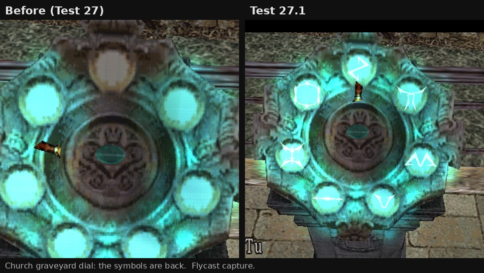
   The church graveyard dial. Left Test 27, right Test 27.1. Flycast capture.
- **Title screen:** the "4" logo and "resident evil" show at full strength, and START on the menu starts the game
  (no second press).

  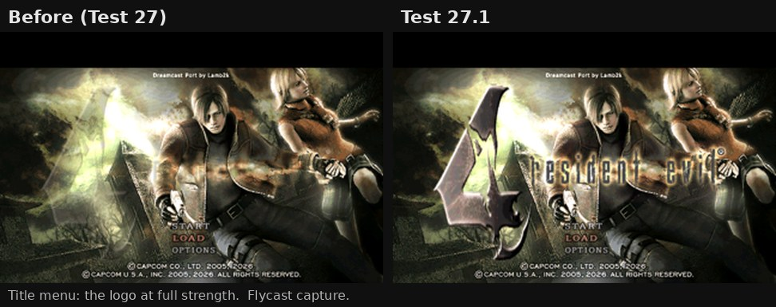
   The title menu. Left Test 27, right Test 27.1. Flycast capture.
- **Item pickups:** the "You got" and "Take the ...?" text shows on a plain dark panel. The room behind the item is
  hidden while the panel is open.

  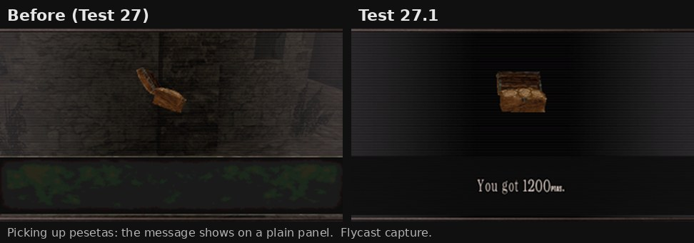
   Picking up pesetas. Left Test 27, right Test 27.1. Flycast capture.
- **Save screen:** the saved row shows the new save count and time right away.

  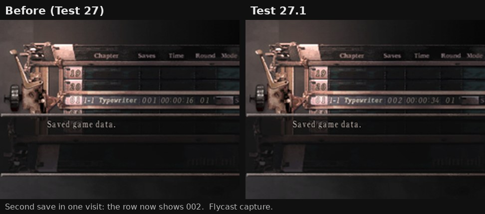
   A second save in one visit. Left Test 27, right Test 27.1. Flycast capture.
- **Safer saving:** a late VMU answer no longer hangs the save screen.
- **Disc reads:** when the drive reports "not ready", the game waits up to 30 seconds before the DISC READ FAILED screen.

Checked on Flycast. Not yet tested on a real console; please tell us in [#66](https://github.com/lamb2k/re4dc/issues/66) how saving, pickups and the merchant
cave play on yours.

## What's new in Test 27

The PS2 sky in normal play, boss fight fixes, more of the castle on Disc 2, and smoother castle rooms.
Full details are in the [release notes](https://github.com/lamb2k/re4dc/releases/latest).

- **The PS2 sky in normal play** in the outdoor rooms, not only in cutscenes.

  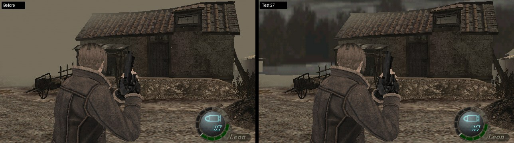
   The village. Left before, right Test 27. Flycast capture.
- **Boss fight fixes:** El Gigante's farm cutscenes and his fade at the village now use his PS2 model, and Del Lago
  keeps his textures after he dies.

  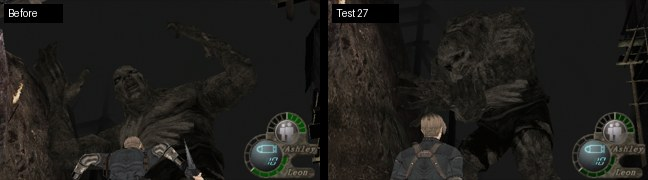
   El Gigante after the fight. Left before (GameCube model), right Test 27 (PS2 model). Flycast capture.
- **No more El Gigante slowdown** after he breaks objects.
- **Save reload crash guard:** reloading a save after dying in the El Gigante fight with Ashley no longer crashes.
- **More of the castle on Disc 2:** the rest of chapter 3-1 with PS2 data, and the rooms of chapters 3-3 and 3-4.
  In normal play they open up when chapter 3-2 joins them in Test 28. The castle Zealots in the lever room and the
  Zealot chase now load without a stall.

  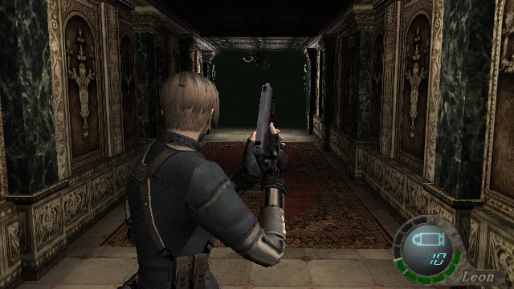
   A castle hall from chapter 3-3. Flycast capture.
- **Smoother castle rooms:** the big pauses in four chapter 3-1 rooms are gone (worst frame from up to 615 ms down
  to under 10 ms in three of them).
- **Faster fights at the dam and the village,** and smoother music streaming with fewer disc reads.
* **Radio call read fixed (issue #63):** the tester's blue screens stop on an odd memory read, and that read no longer happens when a radio call opens. Not yet tested on a real console; please tell us if radio calls or merchant cutscenes still crash.

## Coming soon: Test 28

Planned, with no date yet. Ticked items have passed our checks and will be in Test 28.

- [ ] **The last castle Zealots on the Dreamcast character path:** the Zealot chase and two other castle rooms.
- [ ] **Chapter 3-2** in the castle, which joins chapter 3-1 to the 3-3 and 3-4 rooms in normal play.
- [ ] **Chapter 4.**
- [ ] **Disc 3:** the island and the final chapter.
- [ ] **Torch glow as the PS2 draws it** in the torch rooms.
- [ ] **More PS2 assets:** GameCube ones replaced with PS2 ones in Dreamcast formats.
- [ ] **Smoother heavy rooms:** less far detail where a room runs slow, faster animation loading, and a lighter castle.

## What's new in Test 26

The castle starts on Disc 2, cutscenes get the PS2 sky, and Leon looks right again. Both discs come in the one game zip.
Full details are in the [release notes](https://github.com/lamb2k/re4dc/releases/latest).

- **The castle starts on Disc 2** (chapter 3-1), now with PS2 data for its rooms, characters and animations.

  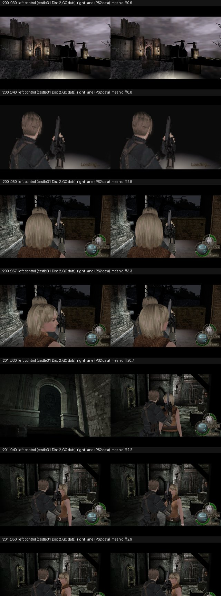
   The castle gate and the first castle rooms. Left GameCube data, right Test 26 PS2 data. Flycast capture.
- **The PS2 sky in cutscenes.**

  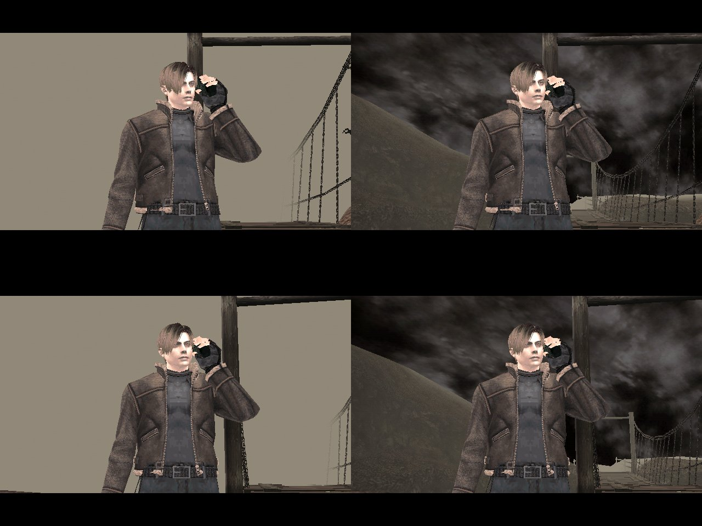
   A radio call on the bridge. Left before, right Test 26. Flycast capture.
- **Leon's lighting is back to the Test 23/24 look**, his pistol included.

  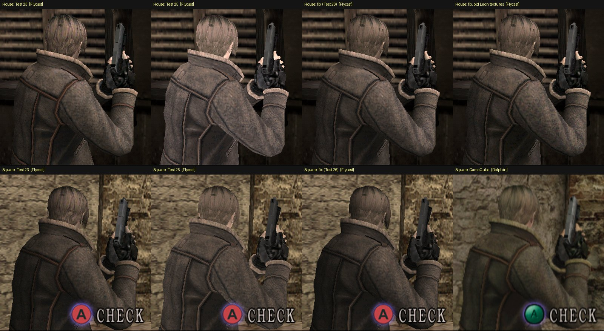
   Leon in a house and the village. Test 23, Test 25 and Test 26 are Flycast captures; the last is GameCube (Dolphin).

  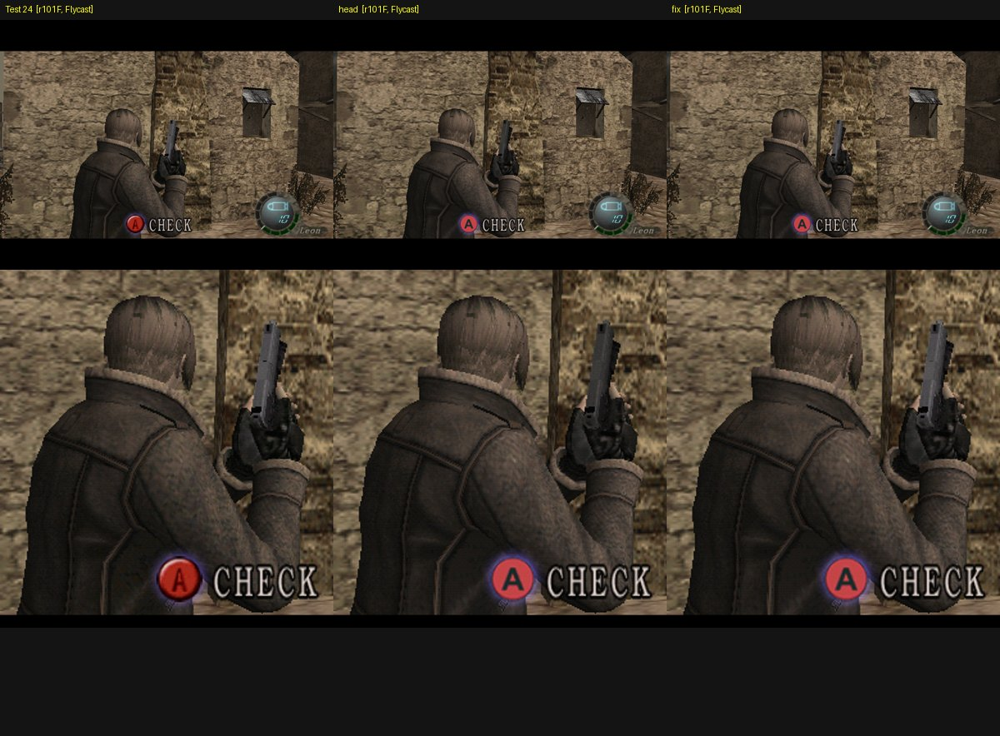
   Leon's pistol in the village. Flycast capture.
- **Faster farmhouse cutscenes.** Scenes inside the farmhouse no longer draw the outdoor world behind the walls.
- **Fixed:** the grab escape prompt shows the Dreamcast stick again (Test 25 showed the PS2 stick), the radio call
  screen opens faster ([#60](https://github.com/lamb2k/re4dc/issues/60)), and VGA output is sharp again
  ([#61](https://github.com/lamb2k/re4dc/issues/61)).
- **QA build only:** the QA link connects reliably again.

## What's new in Test 25

Faster fights, and everything from Test 24 and 24b, which never reached a download. Still up to the castle gate.
Full details are in the [release notes](https://github.com/lamb2k/re4dc/releases/latest).

- **Faster with enemies on screen.** Every character uses one fast lighting path, and we added a set of drawing
  speedups for characters, effects and scenery. On a real console the lighting change alone took the farm barn
  fight from about 5 to 9.5 fps.
- **Leon's dark clothes are no longer crushed to black.**

  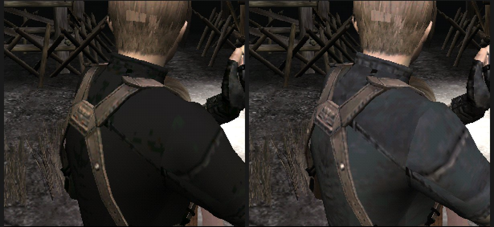
   Leon in chapter 2. Left before the fix, right Test 25. Flycast capture.
- **PS2 sounds** for the partners, crows and every weapon; no more silent weapons.
- **Every weapon is PS2**, and Leon moves on the PS2 skeleton.

  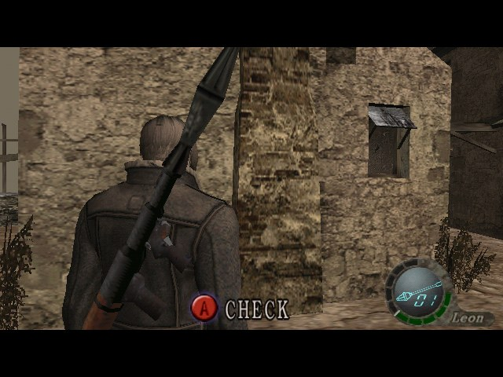
   The PS2 rocket launcher on Leon's back in the village. Flycast capture.
- **Window glass and bars** are back in the forest, village, farm and barn houses.

  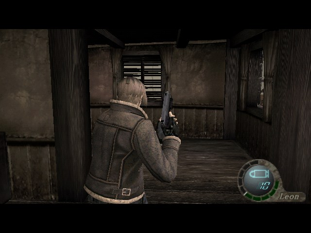
   The first house in the forest: bars and glass in the windows. Flycast capture.
- **Torch rooms run faster.** The night road and other torch rooms no longer draw a fire that fills the screen.

  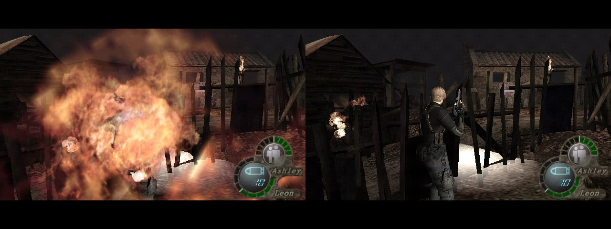
   The night road. Left before the fix, right Test 25. Flycast capture.
- **PS2 torch flames**, and explosions and candle effects are back.
- **PS2 radio call portraits**, and Test 22's button and icon set is back.
- **Hanging cloth and flags** are drawn, and **Leon's flashlight** lights the ground at night ([#55](https://github.com/lamb2k/re4dc/issues/55)).
- **Faster merchant hideout** in the cave, and **PS2 animations** for the last characters that used GameCube ones.
- **More PS2 data:** room props, Ganado bodies, pictures and sounds.

## What's new in Test 24

Test 24 was pulled (missing scenery in the first area), and Test 24b was never published; everything in both is in
Test 25.

- **PS2 weapons and HUD.** Leon's guns come from the PS2, in his hands and in the inventory, with the PS2 HUD.

  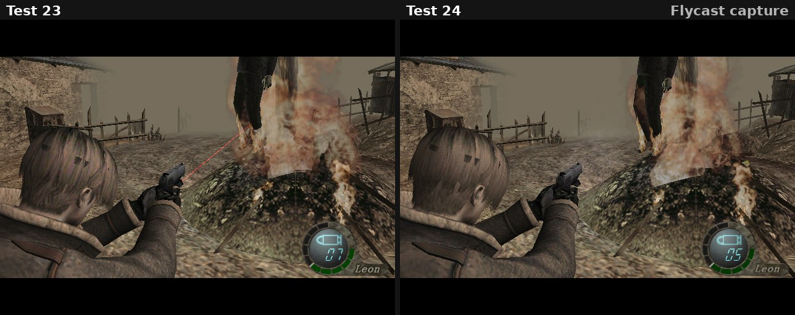
   Aiming in the village. Left Test 23, right Test 24. Flycast capture.
- **PS2 inventory screens and English fonts.**

  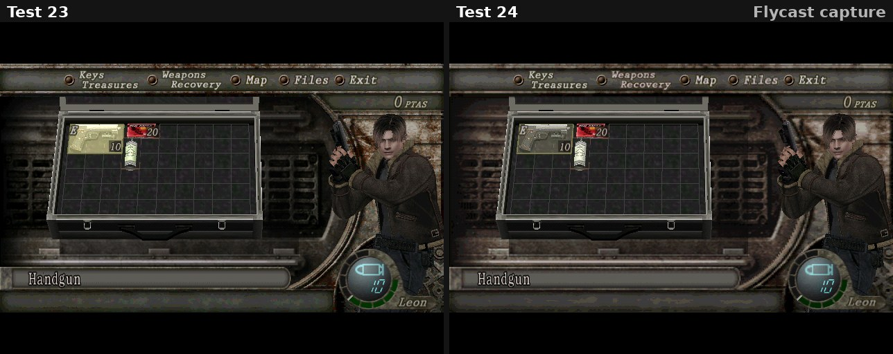
   The inventory. Left Test 23, right Test 24. Flycast capture.
- **Leon's PS2 textures** on his jacket and his chapter 2 outfit.

  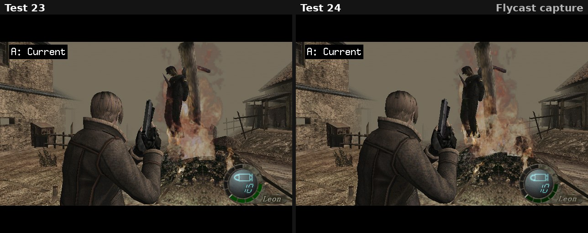
   Leon in the village. Left Test 23, right Test 24. Flycast capture.
- **PS2 animation** for Leon, the Ganados and the weapons.
- **PS2 sounds and music** in chapter 1.
- **PS2 props in chapter 2.** Breakable boxes and barrels, and the torches and window panes the PS2 removed are gone.

  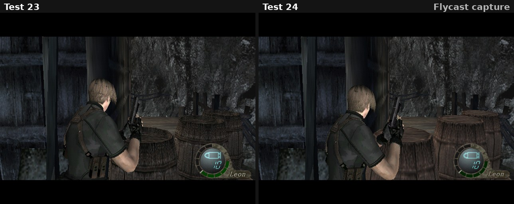
   A room past the dam. Left Test 23, right Test 24. Flycast capture.
- **PS2 church candles.**

  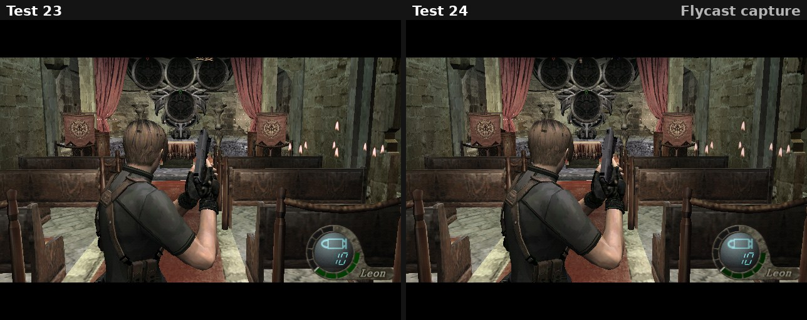
   The church. Left Test 23, right Test 24. Flycast capture.
- **Fixed:** Mendez has his PS2 model in the barn door animation ([#57](https://github.com/lamb2k/re4dc/issues/57)),
  and the Blacktail can be equipped ([#58](https://github.com/lamb2k/re4dc/issues/58)).
- **Under the hood:** the GameCube cutscene files no longer load, and about 13 MB came off the disc.

## What's new in Test 23

PS2 river water, trap fire and a Mendez fix, still up to the castle gate. Full details are in the
[release notes](https://github.com/lamb2k/re4dc/releases/latest).

- **River water.** The cave river, the dam river by the water wheel and the merchant cave pool draw their PS2 water
  ([#55](https://github.com/lamb2k/re4dc/issues/55)).

  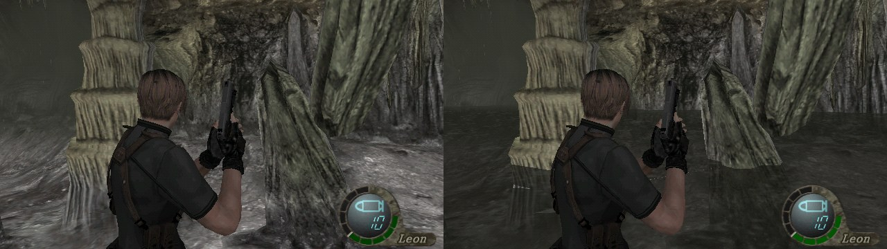
   The cave river. Left Test 22, right Test 23. Flycast capture.
- **Trap explosions.** Tree and door traps explode with fire ([#55](https://github.com/lamb2k/re4dc/issues/55)).

  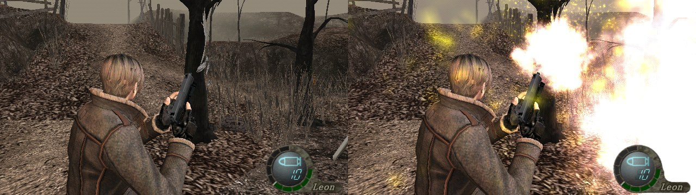
   A tree trap in the forest. Left Test 22, right Test 23. Flycast capture.
- **Mendez keeps fighting.** He no longer freezes after grabbing Leon ([#55](https://github.com/lamb2k/re4dc/issues/55)).
- **Steady barn lights**, and effects in busy rooms stop dropping out ([#55](https://github.com/lamb2k/re4dc/issues/55), [#41](https://github.com/lamb2k/re4dc/issues/41)).
- **No hang on slow disc reads** with DreamShell and similar loaders ([#28](https://github.com/lamb2k/re4dc/issues/28)).
- **Mipmaps in more places.** Bushes and other cut-out pictures get smaller copies too.
- **Fewer see-through effects.** Mist, glows and dust are cut. Blood, fire, explosions, grenades and the laser sight stay.
- **Faster inventory**, and **a better-looking El Gigante** up close.
- **Fixed:** the lever gears ([#52](https://github.com/lamb2k/re4dc/issues/52)), the castle gate texture and the boat weapon display.
- **Safety fixes** for the effect pool, the church light puzzle and the dam encounter.

## What's new in Test 22

Smoother distant textures, fewer pauses and crash and stall fixes, still up to the castle gate. Full details are
in the [release notes](https://github.com/lamb2k/re4dc/releases/latest).

- **Smoother distant textures (mipmaps).** Far ground and walls use smaller copies of their pictures, so they
  shimmer less.

  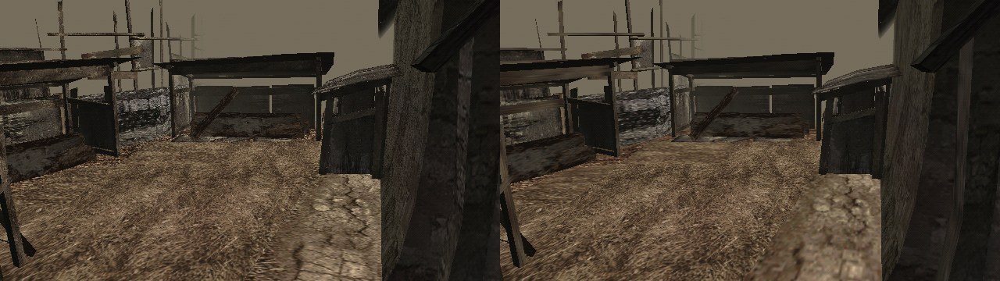
   The village. Left without mipmaps, right Test 22. Flycast capture.

  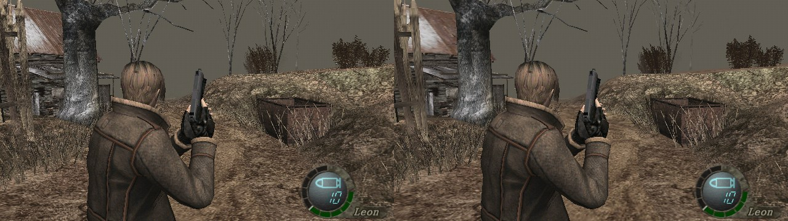
   The farm. Left without mipmaps, right Test 22. Flycast capture.
- **No disc read when you shoot.** The ammo digits and the muzzle flash load with the room.
- **No stutter at in-game events.** Ganados keep their models through scripted moments.
- **Faster inventory opening.** Its data is packed smaller on the disc.
- **Fixed: the crash at the dam's first villager** on a real Dreamcast ([#52](https://github.com/lamb2k/re4dc/issues/52)).
- **Fixed: less free memory after loading a save and resetting** ([#26](https://github.com/lamb2k/re4dc/issues/26)).
- **Fixed: Ganados stalling as they die**, and the death scene after a chainsaw catch.
- **Fixed: pausing in the Mendez fight**, and the world behind the pause menu ([#48](https://github.com/lamb2k/re4dc/issues/48), [#49](https://github.com/lamb2k/re4dc/issues/49)).
- **Lake trees** on the islands no longer look shredded.

  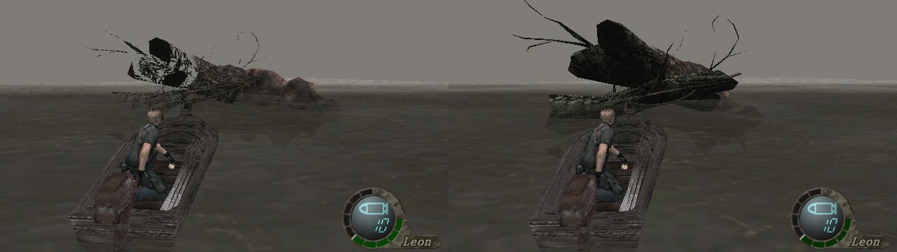
   The lake from the boat. Left Test 21, right Test 22. Flycast capture.
- **Trail and ribbon effects** draw again.
- **Safety guards** stop a failed load from crashing the game.

## What's new in Test 21

Lighter, smoother fights and two places fixed, still up to the castle gate.

- **Fights no longer stall reloading enemy animations** (the r100 ambush, the village fights). In the forest ambush after the house, animation loads dropped from about 700 to about 20, with no disc reads in the last 16 seconds (Flycast measurement).
- **Ashley no longer stalls the game before the El Gigante fight (r11e).**
- **Lighter fights.** Dead bodies and props cost less to run and draw.
- **The night road villagers (r111) use their PS2 model** ([#42](https://github.com/lamb2k/re4dc/issues/42)).

  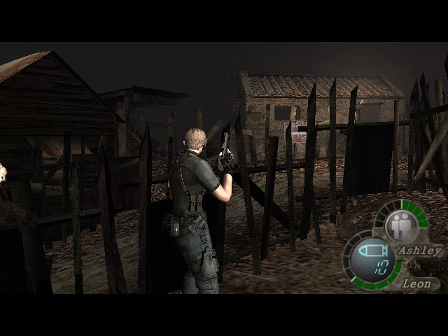
   The night road villagers. Flycast capture, test 21.
- **The dam rooms use the PS2 lighting** ([#47](https://github.com/lamb2k/re4dc/issues/47)).

  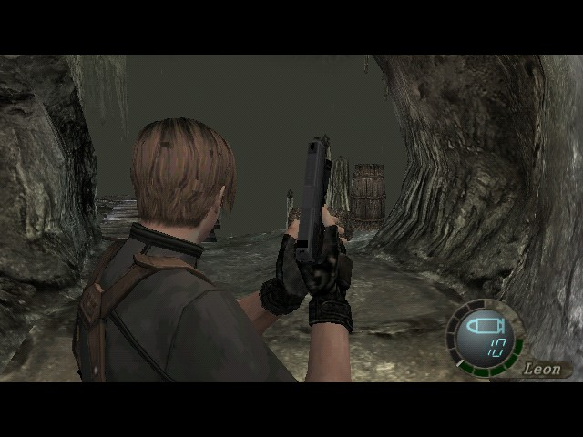
   The dam. Flycast capture, test 21.
- **Steady frame pacing.** Options > Frame pacing > Steady shows every frame for the same time. Fast stays the default.

  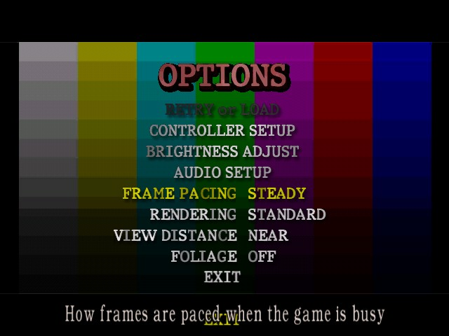
   The Options screen. Flycast capture, test 21.
- **QA build for testers** is a second download: teleports, a weapon kit and a Diagnostics page with a QR code.

## What's new in Test 20

Chapter 2-1's real path: the dam is in. Full details are in the
[release notes](https://github.com/lamb2k/re4dc/releases/latest).

- **The dam (r10c) and the lake's side rooms (r10d, r10e) are playable.** Open the gate, drain the dam and fight
  the Ganados there, as in the original.

  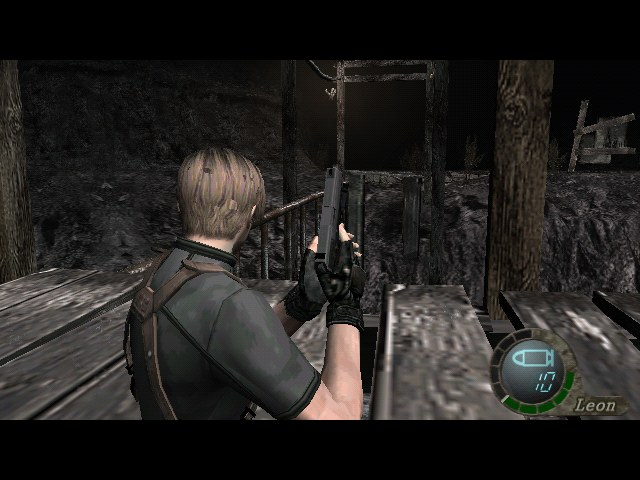
   The dam. Flycast capture, test 20.
- **The Insignia Key is where the game leaves it**, at the dam. The key handover at the dam gate and the two Coming
  Soon doors are gone.

  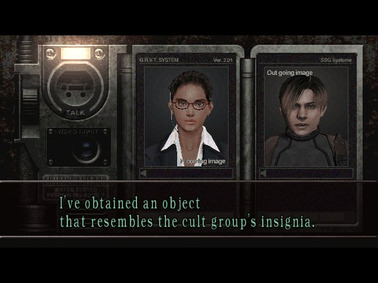
   Taking the key at the dam. Flycast capture, test 20.
- **Faster scenery and enemy logic.** Far scenery uses its lower detail, and far enemies and effects do less work.
  Fights play the same.

## What's new in Test 19.1

A hotfix of Test 19. Full details are in the [release notes](https://github.com/lamb2k/re4dc/releases/latest).

- **The cliff cutscene after the first house plays smoothly again** ([#45](https://github.com/lamb2k/re4dc/issues/45)).
  The scenery now shares repeated corner points, which leaves the cutscene enough memory.
- **No skipped effect sprites in r117** after the Saddler scene starts ([#46](https://github.com/lamb2k/re4dc/issues/46)).
- **Back to the earlier character drawing.** Test 19's new path for Leon and the enemies measured slower, so 19.1
  goes back to the one before it. The picture is the same.

## What's new in Test 19

Quick weapon select, new Options defaults and faster drawing, still up to the castle gate. Full details are in the
[release notes](https://github.com/lamb2k/re4dc/releases/latest).

- **Quick weapon select.** Hold X and press the D-pad to swap weapons, like the RE4 remake: up handguns, right
  shotguns, down grenades, left rifles. Press the same direction again for the next one. The game pauses for a moment
  while the weapon loads.

  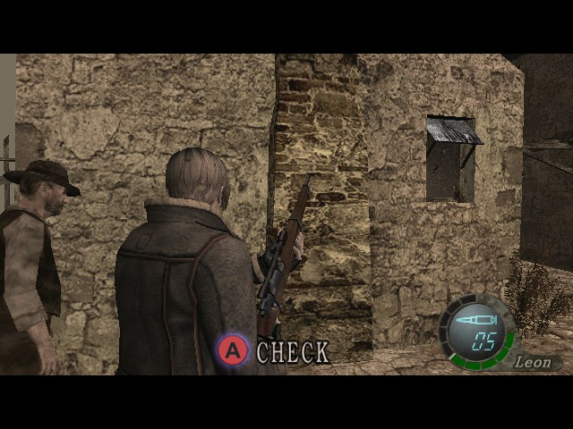
   A quick swap in play. Flycast capture, test 19.
- **New Options defaults.** Foliage starts Off and view distance starts at Near. The lake keeps its long view. You can
  still change both in Options.

  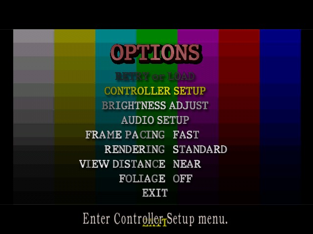
   The Options screen at boot. Flycast capture, test 19.
- **The Player's Manual shows the Dreamcast pages** ([#44](https://github.com/lamb2k/re4dc/issues/44)), not the
  GameCube ones.

  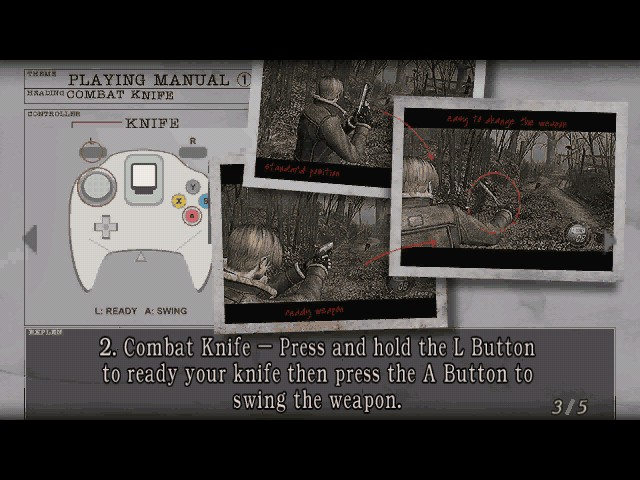
   A Dreamcast manual page. Flycast capture, test 19.
- **Enemies hidden behind walls are no longer drawn.** The game still runs them as before.
- **Faster drawing.** A new path for the scenery and for Leon and the enemies, with the same picture.

## What's new in Test 18

Fixes and a little more speed, still up to the castle gate. Full details are in the [release notes](https://github.com/lamb2k/re4dc/releases/latest).

- **Fix: chapter 2-1 can now be finished** ([#40](https://github.com/lamb2k/re4dc/issues/40)). The Insignia Key for
  the church is given at the gate to the dam, which isn't in the game yet.

  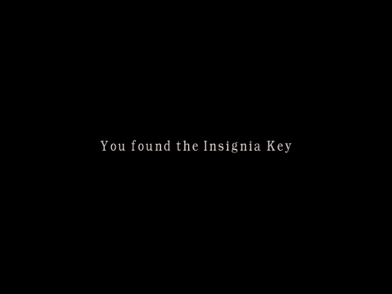
   The key, given at the dam gate. Flycast capture, test 18.
- **A lighter El Gigante** in both fights.

  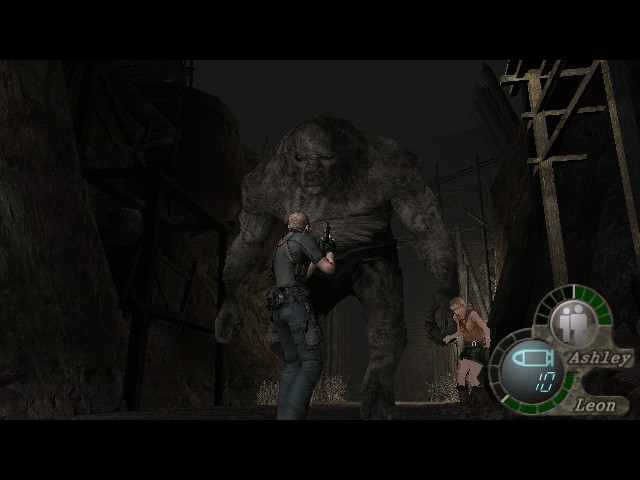
   The lighter El Gigante. Flycast capture, test 18.

- **Leon and El Gigante keep their PS2 models** for the whole first El Gigante fight (r119). Before, both switched to
  the GameCube models for a moment.

  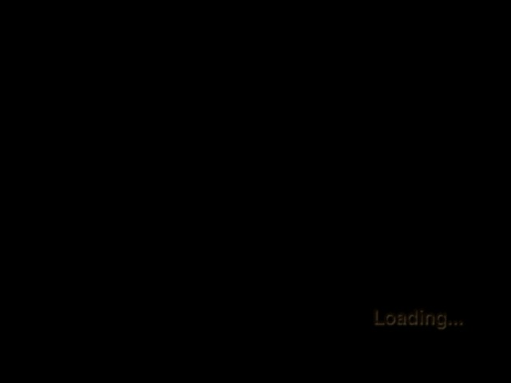
   Leon and El Gigante, both PS2 models. Flycast capture, test 18.

- **Leon keeps his PS2 model after a chainsaw kill**, for the whole death scene.

  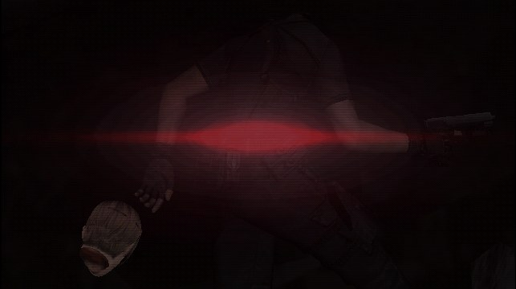
   Leon's death scene, PS2 head. Flycast capture of the test 18 program in a castle test room.

- **Effect pictures are there right after loading a save** in r102 ([#33](https://github.com/lamb2k/re4dc/issues/33)).

- **A little faster in play.** Leon's jacket movement is worked out only for pictures that are shown.
- **A little faster in the village and at the farm.** Mist sheets the PS2 version never shows are no longer moved, and more scenery stays ready in memory.
- **No more disc reads for pictures** during the first house fight (r100) and at the night lake shore (r11b).
- **No sound gap in cutscenes** ([#38](https://github.com/lamb2k/re4dc/issues/38)). The Mendez cutscene still ends as
  soon as you pass its button prompt, as in the original game.
- **The world picture and the effect pictures on the way to the castle gate are back** ([#39](https://github.com/lamb2k/re4dc/issues/39)).
  For about a second in r200, some effect sprites can still be skipped ([#41](https://github.com/lamb2k/re4dc/issues/41)).

## What's new in Test 17.1

A hotfix of Test 17.

- **Coming Soon no longer traps you.** Chapter 2-1 has two ways forward and this test carries one. A door off the
  test's path shows Coming Soon, then returns you to the room so you can take the other exit.

  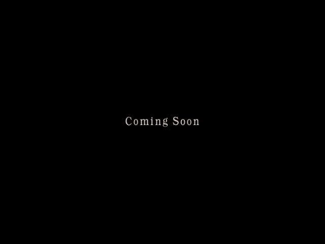
   The Coming Soon screen. Flycast capture, test 17.1.

## What's new in Test 17

Chapters 2-2 and 2-3 are playable, up to the castle gate.

- **Chapters 2-2 and 2-3.** The cabin siege with Luis, Mendez, the second El Gigante and the truck ride to the
  castle gate (r200), with the PS2 enemy lists. At most 4 Ganados at once, as in chapter 1.

  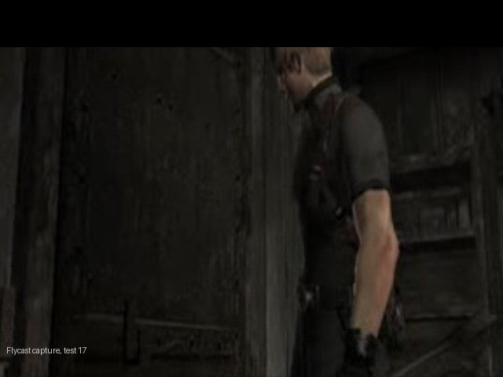
   In the cabin, chapter 2-2. Flycast capture, test 17.

- **PS2 Ashley** in every room she follows Leon.

  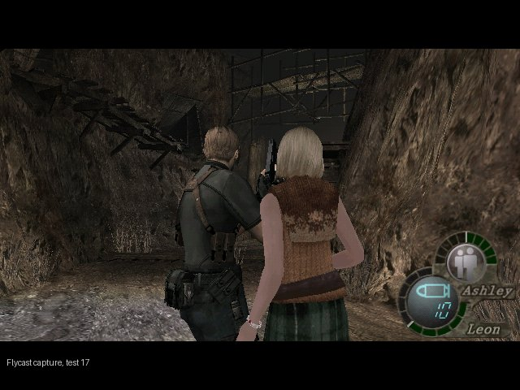
   Leon and Ashley. Flycast capture, test 17.

- **Mendez and El Gigante as lighter PS2 models** in their fights.

  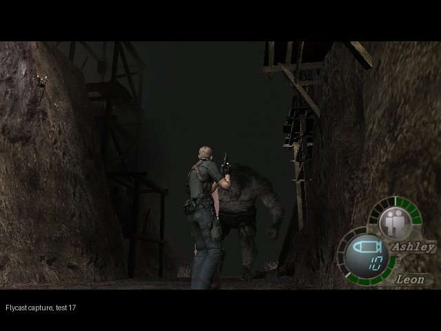
   El Gigante. Flycast capture, test 17.

- **Rain at the night lake** ([#30](https://github.com/lamb2k/re4dc/issues/30)): 320 falling streaks, drawn the
  Dreamcast way. It is cheaper than the old faint lines.

  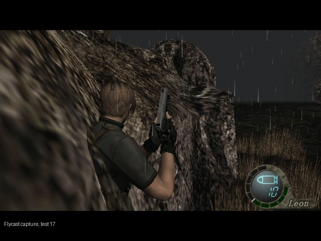
   Rain at the night lake. Flycast capture, test 17.

- **The castle gate (r200)** is the end of this test.

  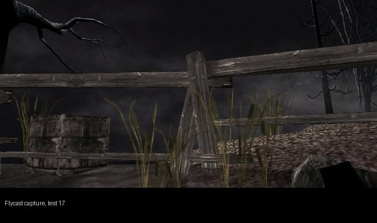
   Outside the castle, where this test ends. Flycast capture, test 17.

- **Solid scenery draws solid** in every chapter 2 room too (the 16.5 change). The new rooms look the same.
- **Fewer pauses in fights.** The Ganado animations the fights use load with the room, and Ganados that lose their
  head keep their PS2 model.
- **Short view distance** draws a simplified far view in the first area and the village.
- **The small picture missing in r118 is back** ([#37](https://github.com/lamb2k/re4dc/issues/37)).

## Play it

One download plays on a real Dreamcast with GDEMU, or in Flycast. No BIOS or VMU saves are included.

| File on the release page | What it is |
| --- | --- |
| `RE4DC-Console-Test-...-GDEMU.zip` | The game disc. This is the one to download. |
| `SHA256SUMS.txt` | Checksums for the zips. |
| `RE4DC-Test18-...-Build-Assets.zip` | Only for building the program from source. Not needed to play. |

**On a Dreamcast with GDEMU:**

1. Extract the zip.
2. Copy the four files inside `gdemu` into a new numbered folder on the SD card. Keep the file names.
3. Replace any older test folder. Do not mix track files from two tests.
4. If your card manager offers "Shrink GDI", leave it off.

**In Flycast:**

1. Extract the zip. Do not open the zip itself.
2. Open `gdemu/disc.gdi` from the extracted folder, with the track files beside it.

**Flycast tips** (from [#35](https://github.com/lamb2k/re4dc/issues/35), seen in Flycast 2.7):

- **Turn off Widescreen, Widescreen Game Cheats and Super Widescreen.** The game draws 4:3; widescreen shows undrawn side areas.
- **Broken menu or popup text?** Use Flycast's per-pixel renderer setting.

The disc is a standard GD-ROM image, laid out like a pressed disc
([section 8 of CONTRIBUTING-PORT.md](port/dreamcast/CONTRIBUTING-PORT.md#8-disc-image-and-compatibility)).

| Action | Dreamcast pad |
| --- | --- |
| Move | Analog stick |
| Aim / fire | Hold R, press A |
| Action / talk / pick up | A |
| Run / cancel | B |
| Knife | L |
| Inventory | Y |
| Quick weapon (from Test 19) | Hold X, press the D-pad: up handguns, right shotguns, down grenades, left rifles and others. Press again for the next one. |
| Pause / options | START |
| Speed display on / off | Hold R, press START |

**Options:**

- **Frame pacing:** Fast is the default. Saved on the VMU.
- **Rendering:** Standard (default) or FSAA, which smooths edges but is slower in busy scenes.
- **View distance:** Full (as on the PS2), Near or Short. Near and Short fade distant scenery sooner and run faster. From Test 19 every boot starts at Near; the lake always keeps its full view.
- **Foliage:** Full, Near or Off. Off is fastest; walls, floors and water always draw. From Test 19 every boot starts at Off (Near before).
- Rendering, View distance and Foliage reset at every boot.

The VMU in controller slot 1 shows Leon, Ashley, Hunnigan and Luis pages.

## Known issues

The full, current list is [KNOWN_ISSUES.md](port/dreamcast/docs/KNOWN_ISSUES.md). The top open items:

- **Some effect sprites skipped for about a second** in r200, at the castle gate ([#41](https://github.com/lamb2k/re4dc/issues/41)).
- **Pauses when entering rooms.**

## Help out

**Testers:** use the [Game bug form](https://github.com/lamb2k/re4dc/issues/new/choose).

- **Say** the build, the room or chapter, the steps, and Flycast or Dreamcast (with your loader).
- **Attach** a screenshot or video. For a console crash, a clear photo of the whole diagnostic screen.
- **One bug per issue.**

**Contributors:**

- **Clone with submodules:** `git clone --recurse-submodules https://github.com/lamb2k/re4dc.git` (SH4ZAM is a submodule).
- **Build and swap in one command:** `bash port/dreamcast/contrib.sh` builds your program and puts it on the latest test disc.
- **Read first:** [CONTRIBUTING-PORT.md](port/dreamcast/CONTRIBUTING-PORT.md), then [CLAUDE.md](CLAUDE.md) or
  [AGENTS.md](AGENTS.md) ("Outside contributors start here").
- **Branch from `dreamcast-port`:** one change per PR, behind a default-off knob, no game data.

## How it works

The original game logic, with a Dreamcast-native picture.

- **Recovered GameCube code** runs the gameplay, collision and enemy AI, built for the SH-4 with KallistiOS.
- **A native PowerVR renderer** replaces the GameCube graphics.
- **PS2 room and character assets,** converted offline, are lighter for the Dreamcast.
- **VMU saves** stand in for the memory card, and **cutscene movies stream** from the disc.

  

More in the [port notes](port/dreamcast/README.md), the [build recipes](port/dreamcast/tools/d367/README.md),
[engine overview](docs/overview.md).

## Credits and legal

Built on the [RE4 GameCube decompilation](docs/DECOMPILATION.md),
[KallistiOS](https://github.com/KallistiOS/KallistiOS) and [Flycast](https://github.com/flyinghead/flycast).
Third-party code in the program and its licences: [THIRD_PARTY_NOTICES.md](THIRD_PARTY_NOTICES.md).
An independent fan project for research and preservation, not affiliated with Capcom, Sega or Nintendo.
Resident Evil is a Capcom trademark; game code and data belong to their owners. Project tools and
documentation are [CC0](LICENSE).
