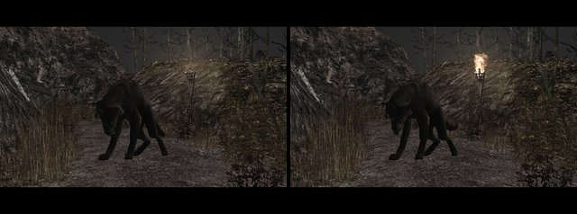
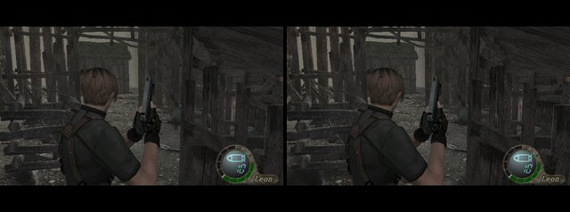

# RE4 Dreamcast

**Resident Evil 4 runs on the Sega Dreamcast, from New Game to the end of chapter 2-1.**

It is the GameCube game's own recovered code, not a remake, drawn by a native Dreamcast renderer.
This is an experimental fan test build, not the complete game.

**[Download Test 16.5](https://github.com/lamb2k/re4dc/releases/latest)** · [Known issues](port/dreamcast/docs/KNOWN_ISSUES.md) ·
[Port notes](port/dreamcast/README.md) · [Build the port](port/dreamcast/CONTRIBUTING-PORT.md) · [Decompilation](docs/DECOMPILATION.md)

## What's new in 16.5

A small hotfix for chapters 1 and 2-1. Full details are in the [release notes](https://github.com/lamb2k/re4dc/releases/latest).

- **Torch flames are back at the night lake** ([#30](https://github.com/lamb2k/re4dc/issues/30)). The rain is still missing.

  
   Night lake torches, before and after. Flycast capture, test 16.5.

- **Solid scenery draws solid.** See-through parts whose pictures are really solid now draw as solid, and near-hard
  cut-out cards as cut-outs, in every chapter 1 and 2-1 room. It is cheaper for the graphics chip. Most rooms look
  the same; the cabin (r109) changes slightly.

  
   The cabin (r109), before and after. Flycast capture, test 16.5.

- **Smaller room-entry hitch.** Contributed by Bruceleeto.

## Coming soon: Test 17

Test 17 is being built now. Planned, with no date yet:

- **Chapters 2-2 and 2-3** playable, up to the castle gate (r200).
- **Full PS2 Ashley.**
- **Mendez and El Gigante** as lighter PS2 models.
- **A new Dreamcast rain** at the night lake.
- **Flat and card scenery** (the 16.5 change) in every room of the new chapters.
- **Fewer disc reads** during fights.

Screenshots come with the release.

## Play it

One download plays on a real Dreamcast with GDEMU, or in Flycast. No BIOS or VMU saves are included.

| File on the release page | What it is |
| --- | --- |
| `RE4DC-Console-Test-...-GDEMU.zip` | The game disc. This is the one to download. |
| `SHA256SUMS.txt` | Checksums for the zips. |
| `RE4DC-Test16.5-...-Build-Assets.zip` | Only for building the program from source. Not needed to play. |

**On a Dreamcast with GDEMU:**

1. Extract the zip.
2. Copy the four files inside `gdemu` into a new numbered folder on the SD card. Keep the file names.
3. Replace any older test folder. Do not mix track files from two tests.
4. If your card manager offers "Shrink GDI", leave it off.

**In Flycast:**

1. Extract the zip. Do not open the zip itself.
2. Open `gdemu/disc.gdi` from the extracted folder, with the track files beside it.

**Flycast tips** (from [#35](https://github.com/lamb2k/re4dc/issues/35), seen in Flycast 2.7):

- **Turn off Widescreen, Widescreen Game Cheats and Super Widescreen.** The game draws 4:3; widescreen shows undrawn side areas.
- **Broken menu or popup text?** Use Flycast's per-pixel renderer setting.

The disc is a standard GD-ROM image, laid out like a pressed disc
([section 8 of CONTRIBUTING-PORT.md](port/dreamcast/CONTRIBUTING-PORT.md#8-disc-image-and-compatibility)).

| Action | Dreamcast pad |
| --- | --- |
| Move | Analog stick |
| Aim / fire | Hold R, press A |
| Action / talk / pick up | A |
| Run / cancel | B |
| Knife | L |
| Inventory | Y |
| Pause / options | START |
| Speed display on / off | Hold R, press START |

**Options:**

- **Frame pacing:** Fast is the default. Saved on the VMU.
- **Rendering:** Standard (default) or FSAA, which smooths edges but is slower in busy scenes.
- **View distance:** Full (default, as on the PS2), Near or Short. Near and Short fade distant scenery sooner and run faster.
- **Foliage:** Near (default), Full or Off. Off is fastest; walls, floors and water always draw.
- Rendering, View distance and Foliage reset at every boot.

The VMU in controller slot 1 shows Leon, Ashley, Hunnigan and Luis pages.

## Known issues

The full, current list is [KNOWN_ISSUES.md](port/dreamcast/docs/KNOWN_ISSUES.md). The top open items:

- **No rain at the night lake** (start of chapter 2-1). A new Dreamcast rain is planned for Test 17.
- **Missing effect pictures in r102** right after loading a save ([#33](https://github.com/lamb2k/re4dc/issues/33)).
- **Pauses when entering rooms.**

## Help out

**Testers:** use the [Game bug form](https://github.com/lamb2k/re4dc/issues/new/choose).

- **Say** the build, the room or chapter, the steps, and Flycast or Dreamcast (with your loader).
- **Attach** a screenshot or video. For a console crash, a clear photo of the whole diagnostic screen.
- **One bug per issue.**

**Contributors:**

- **Clone with submodules:** `git clone --recurse-submodules https://github.com/lamb2k/re4dc.git` (SH4ZAM is a submodule).
- **Build and swap in one command:** `bash port/dreamcast/contrib.sh` builds your program and puts it on the latest test disc.
- **Read first:** [CONTRIBUTING-PORT.md](port/dreamcast/CONTRIBUTING-PORT.md), then [CLAUDE.md](CLAUDE.md) or
  [AGENTS.md](AGENTS.md) ("Outside contributors start here").
- **Branch from `dreamcast-port`:** one change per PR, behind a default-off knob, no game data.

## How it works

The original game logic, with a Dreamcast-native picture.

- **Recovered GameCube code** runs the gameplay, collision and enemy AI, built for the SH-4 with KallistiOS.
- **A native PowerVR renderer** replaces the GameCube graphics.
- **PS2 room and character assets,** converted offline, are lighter for the Dreamcast.
- **VMU saves** stand in for the memory card, and **cutscene movies stream** from the disc.

  

More in the [port notes](port/dreamcast/README.md), the [build recipes](port/dreamcast/tools/d367/README.md),
[engine overview](docs/overview.md).

## Credits and legal

Built on the [RE4 GameCube decompilation](docs/DECOMPILATION.md),
[KallistiOS](https://github.com/KallistiOS/KallistiOS) and [Flycast](https://github.com/flyinghead/flycast).
Third-party code in the program and its licences: [THIRD_PARTY_NOTICES.md](THIRD_PARTY_NOTICES.md).
An independent fan project for research and preservation, not affiliated with Capcom, Sega or Nintendo.
Resident Evil is a Capcom trademark; game code and data belong to their owners. Project tools and
documentation are [CC0](LICENSE).
