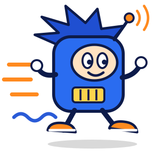
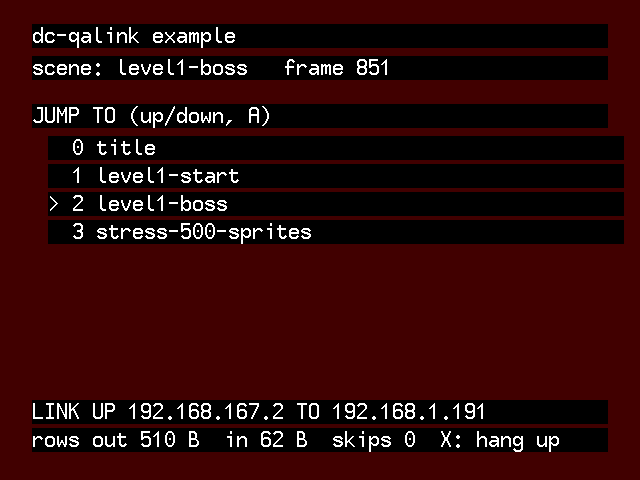
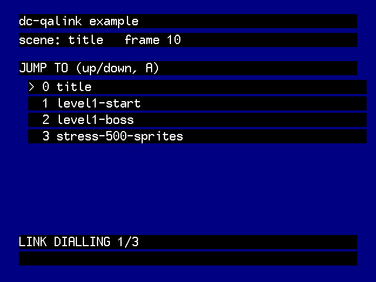
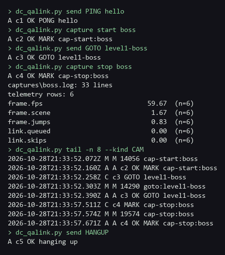

<p align="center"></p>

# dc-qalink

A QA and telemetry link for KallistiOS (KOS) Dreamcast programs, over the console's own 56k modem.

- **Measure on real hardware:** your program sends `key=value` telemetry once a second; the PC cuts labelled sections
  and averages them.
- **Drive it remotely:** send commands (`PING`, `GOTO level1-boss`, your own) from a PC or a coding agent.
- **Costs nothing on the frame:** the game thread only copies into bounded rings; dialling, PPP and sockets run on
  background threads with static stacks. Off by default at compile time (`DCQL_ENABLE=0`).

<p align="center">
</p>
<p align="center"><sub>Flycast captures of example/ through Flycast's emulated modem: connected after a remote
<code>GOTO level1-boss</code>, and dialling.</sub></p>

## Hardware

- A Dreamcast with its modem, and a PPP peer on a phone line: a **DreamPi** (Raspberry Pi + USB modem + line
  inducer), or any Linux box with a voice modem and `pppd`.
- A PC on the same network as the Pi. Flycast's modem emulation works for development (no Pi needed).

```
Dreamcast --modem/PPP--> DreamPi (relay, UDP 52040) <--ssh/TCP 52041-- PC (dc_qalink.py)
```

## Setup in 5 steps

1. **Add the library** to your KOS Makefile (see `example/Makefile`):
   `DCQL_DIR := path/lib`, `include $(DCQL_DIR)/dcql.mk`, add `$(DCQL_OBJS)`, `$(DCQL_CFLAGS)`, `$(DCQL_LDFLAGS)`.
   Build QA discs with `make DCQL_ENABLE=1`; retail builds leave it off.
2. **Call it:** `dcql_config()`, `dcql_set_command()`, `dcql_start()` once; `dcql_poll()` every frame;
   `dcql_telemetry("frame fps=60 scene=3\n")` once a second.
3. **Set up the Pi** from the PC: `python relay/pi_setup.py` (finds the Pi, installs a key and the relay service).
   On any other pppd box: `sudo relay/install.sh`.
4. **Dial** from the console (auto at boot, or a menu item). Check: `python pc/dc_qalink.py --ssh dreampi send PING`.
5. **Measure:** `capture start fight`, play, `capture stop` writes `captures/fight.log` and `fight.summary.txt`.

<p align="center"></p>
<p align="center"><sub>PC side of the same Flycast run: PING, a labelled capture around a remote GOTO, the summary
and the marker echoes in the relay log.</sub></p>

Flycast instead of a Pi: run the relay on the PC, set `[network] DCNet = no` in emu.cfg, configure the console with
`cfg.host = "<PC address>"` and `cfg.lport = 52042` (Flycast opens the console's port on the PC). For the example:
`make CFLAGS_EXTRA='-DEX_HOST=\"192.168.1.10\" -DEX_LPORT=52042'`, then load `dcql-example.elf` in Flycast.

## API (`lib/dcql.h`)

| Call | What it does |
|---|---|
| `dcql_config(&cfg)` | Dial number, relay host (or learn the peer), ports, PAP login, `bulk_ok` / `log` hooks |
| `dcql_start()` / `dcql_stop()` | Dial (3 tries) or hang up, in the background; both return at once. `start` after a drop redials |
| `dcql_poll()` | Per frame: runs received commands (built in: `PING`, `MARK`, `STATUS`; others go to your handler) |
| `dcql_set_command(fn, user)` | Your handler: `int fn(id, VERB, args, user)`; return 0 for "unknown" |
| `dcql_telemetry(body)` / `dcql_log(text)` | Queue a T / L row (multipart, split at line ends; skipped, not queued, when backlogged) |
| `dcql_answer(id, ok, fmt, ...)` | Answer a command |
| `dcql_mark(label)` | A marker row, echoed three ways for robust capture cuts |
| `dcql_state()` / `dcql_state_text()` / `dcql_counters()` | For your on-screen status line and telemetry |

## Wire format (UDP, text, one row per datagram, at most 1200 bytes)

| Row | From | Format |
|---|---|---|
| Command | PC | `<id> <VERB> [args]` |
| A answer | console | `A <id> OK\|ERR <text>` |
| T telemetry | console | `T <seq> <ms> <part>/<parts>\n<name k=v k=v ...lines>` |
| L log | console | `L <seq> <part>/<parts>\n<text>` |
| M mark | console | `M <ms> <label>` (plus `A <id> OK MARK <label>` and an L line `dcql-mark: <label>`) |

The relay logs each line as `<UTC time> <kind> <text>` and adds `C` (commands it sent) and `S` (its own state). A
capture cut accepts any echo of a marker (C, M, A or the L line), so one lost datagram never loses a section.

## Limits and footprint

- Measured with KOS 2.x (GCC 15.2), example ELF with vs without the link: **+49.0 KB code, +1.0 KB data,
  +31.4 KB BSS** (the library itself: 6.1 KB code, 28 KB BSS; libppp 8.3 KB code). Includes the KOS modem, PPP, UDP
  and socket code it pulls in.
- Threads: dial (8 KiB stack, while dialling), PPP (4 KiB, while connected), modem timer worker (4 KiB). All stacks
  are static. KOS heap: thread records plus a socket, about 2.5 KiB while up; each received datagram is freed on the
  same pass.
- Rings: 4 KiB each way. Telemetry and log rows are admitted only while under 2400 queued bytes (about 0.7 s of line
  at 33.6 kbps), so a slow line never grows the backlog; answers and marks use the rest.
- No IPv4 fragment reassembly (KOS without `net_init()`): every datagram stays under 1200 bytes both ways.
- Hang-up never destroys a thread that may hold libppp's lock; if PPP does not leave in 3.2 s the state is
  `FAILED (-31)` and the next `dcql_start()` retries.
- Uses `--wrap` on three KOS symbols and renames four in libppp; tested against KOS at commit 804b319.

## Agent skills

`skill/` holds three short skills for coding agents (Claude Code and similar): `dc-qalink-integrate` (add the library
to a KOS game), `dc-qalink-pi-setup` (set up the relay on a Pi) and `dc-qalink-capture` (measure on hardware).

## Tests

`python3 -m unittest discover -s tests` runs the relay and PC tool against a fake console (loss, reorder, a dropped
start marker) and checks `pi_setup.py`'s discovery parsing, ssh config writing and dry run.

## Licence

MIT (see LICENSE). KallistiOS and libppp are under their own licences (THIRD_PARTY.md). The mascot (Dialo) is
original art for this kit, under the same MIT licence. Not affiliated with Sega.
